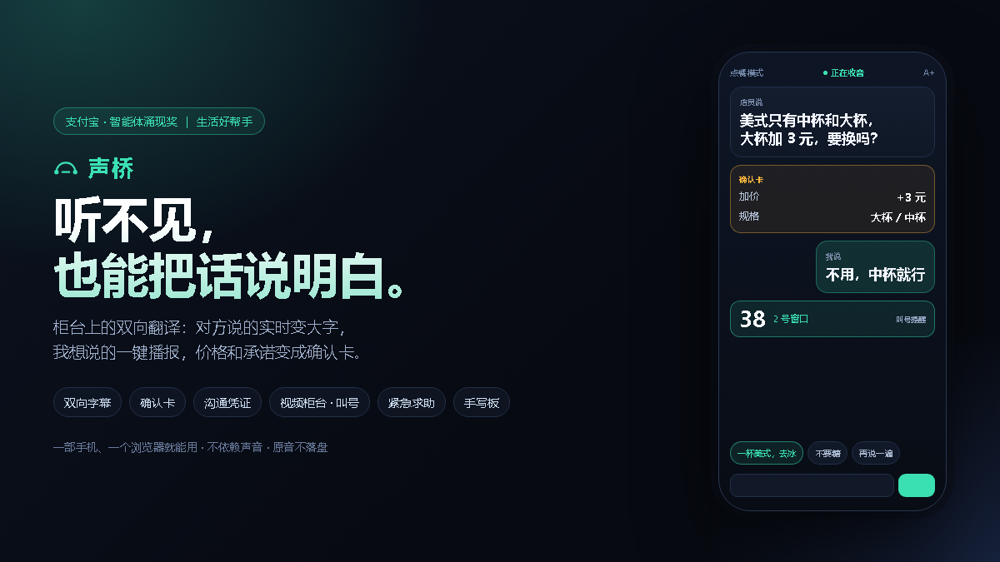
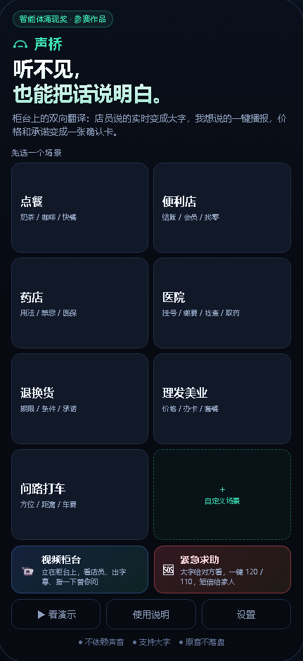
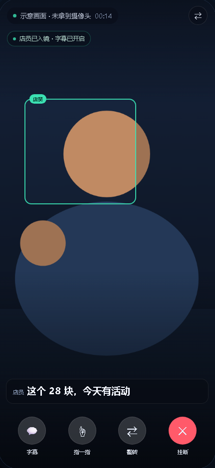
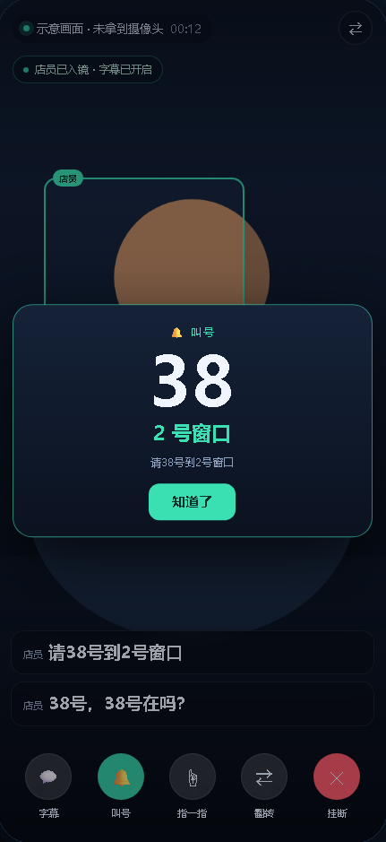

# 声桥 · 听障人士线下消费沟通助手

> 柜台上的双向翻译：对方说的实时变成大字，我想说的一键播报，价格和承诺变成一张确认卡，最后留下一条沟通凭证。
>
> 参赛作品 · 支付宝「智能体涌现奖」· 生活好帮手赛道

---

## 立即使用

- **在线版**：<https://lpcgit-cpu.github.io/shengqiao/>（部署后替换；手机/电脑打开即用）
- **单文件版**：下载本仓库的 `index.html`，双击即可离线运行
- **本地预览**：`python -m http.server 8000` → <http://localhost:8000>

> 语音识别与摄像头需要 **https 或 localhost**；微信内置浏览器不支持语音识别，会自动切到演示/打字模式。



---

## 它解决什么

听障者在柜台前最难的不是"听不见"三个字，而是一整条链：
**听不到 → 听不懂 → 说不清 → 不敢问 → 被推销 → 出了问题没凭证。**

声桥把这条链拆成四件事：**听得见（字幕）、说得出（播报）、算得清（确认卡）、留得下（凭证）**。

| 场景 | 具体做法 |
| --- | --- |
| 点餐 / 便利店 | 对方说话实时变大字，点词组替你说话，金额规格自动高亮 |
| 医院 / 药店 | 自动抽出楼层、空腹、用法、金额；遇到"自费"会提示 |
| 退换货 / 预付卡 | 确认卡把口头承诺变成可确认的信息，一键生成维权文本 |
| 紧急情况 | 整屏大字"请帮我打 120"，一键拨号 / 短信给家人 |
| 视频柜台 | 手机立在柜台上：店员入镜自动出字幕、听到叫号震动弹号码、手指一下替你问 |
| 对方不会说 | 递屏页切「您写给我」，对方直接手写 |



---

## 功能一览

1. **双向字幕**：实时转写 + 关键词高亮（金额 / 规格 / 期限 / 楼层 / 用法）
2. **一键播报**：点词组或打字，手机替我说；每条都能重播
3. **确认卡**：自动抽取"可确认的事实"，点"都对 / 不对，重问"
4. **风险拦截**：办卡、充值、押金、自费、自动续费、分期、不退不换 → 大字提示 + 拒绝话术
5. **递屏 + 手写板**：整屏大字给对方看；对方可直接手写
6. **沟通凭证 + 投诉材料**：确认项、风险、对话全记录；一键生成 12315 可用文本
7. **视频柜台**：店员识别、实时字幕、指一指确认书、**叫号提醒**（38 号 · 2 号窗口）
8. **紧急求助**：大字 + `tel:120/110` + 含时间位置短信
9. **7 个场景 + 自定义场景**：可长按拖动排序、隐藏、移到最前
10. **常用语**：按使用次数自动排序、长按置顶、拖动排序、面板 ▲▼ 排序、全局常用语
11. **设置**：字号三档（标准/大/特大）、导出/导入设置、清空本机数据
12. **30 秒上手**：首次打开自动引导，一键看演示




---

## 技术说明

| 项 | 说明 |
| --- | --- |
| 形态 | **单文件 HTML**（CSS / JS 全部内联） |
| 体积 | 约 157 KB |
| 依赖 | **零依赖**，不引用任何 CDN、字体、外部接口 |
| 运行 | 双击即开；`file://` 可用（语音/摄像头会降级） |
| 语音 | 浏览器内置识别 + 语音合成；不可用时自动演示/打字 |
| 存储 | 场景、常用语、偏好只存 `localStorage`，不上传 |
| 适配 | 手机满屏；桌面按 9:19.5 手机比例显示 |

---

## 隐私

- 不录音、不上传、不建账号；
- 原音不落盘，只有你主动生成的文字凭证留在本机；
- 收音前建议告知对方，「递屏」页已写明"我听不见"。

---

## 目录

```
index.html          单文件应用（部署入口）
shots/              截图与 16:9 封面
听障痛点与对策.md     调研结论与改动对照
提交材料草稿.md       参赛文案草稿
部署说明.md          三种上线方式 + 验证清单
```
